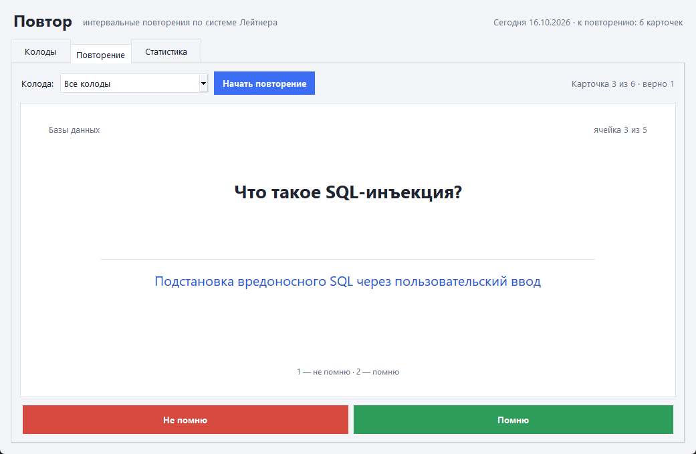
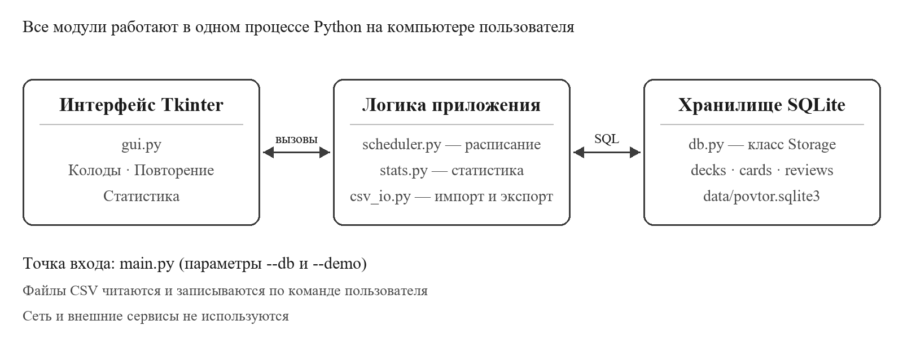
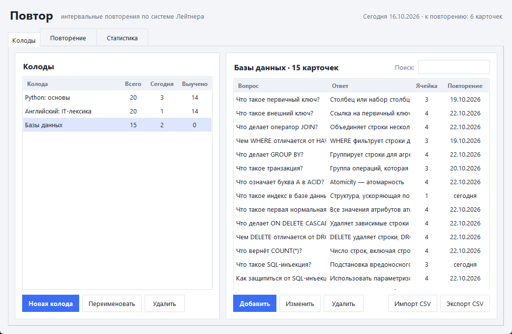
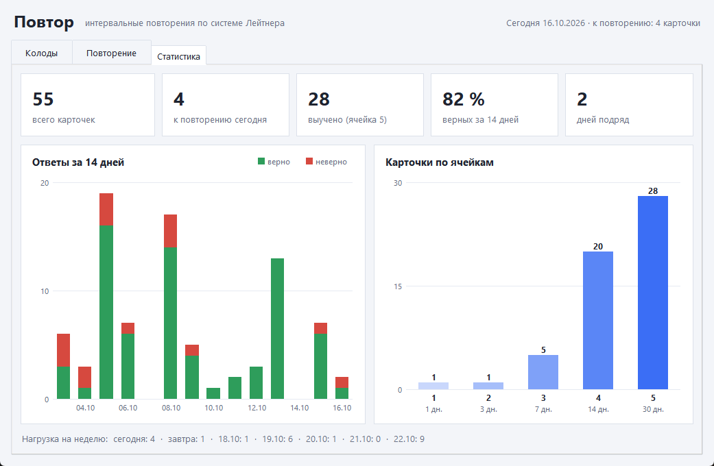

# Повтор — тренажёр карточек с интервальными повторениями

Настольное приложение на Python для запоминания учебного материала: терминов,
определений, иностранных слов. Пользователь создаёт колоды карточек «вопрос — ответ»,
а программа сама решает, какие карточки показать сегодня, по **системе Лейтнера**:
то, что вспоминается легко, повторяется всё реже, а ошибки возвращаются в работу на
следующий день.

Учебный проект (2 курс). Используется только стандартная библиотека Python:
`tkinter`, `sqlite3`, `csv`, `unittest`.



## Возможности

- колоды и карточки: создание, переименование, изменение, удаление, поиск;
- сессия повторения по всем колодам или по одной, горячие клавиши
  (Пробел — показать ответ, 1 — не помню, 2 — помню);
- расписание по пяти ячейкам Лейтнера, ошибка ещё раз показывается в конце сессии;
- статистика: ответы за 14 дней, распределение по ячейкам, точность, серия дней,
  нагрузка на неделю;
- импорт карточек из CSV (разделитель `;`, `,` или табуляция) и экспорт колоды в CSV;
- демонстрационная база с тремя колодами и историей занятий за пять недель.

## Запуск

Нужен Python 3.9 или новее (проверено на 3.13). Сторонние пакеты не требуются.
В Linux может понадобиться пакет `python3-tk`.

```bash
git clone https://github.com/Ferumit/povtor.git
cd povtor
python main.py           # своя база: data/povtor.sqlite3
python main.py --demo    # демонстрационная база: data/demo.sqlite3
python main.py --db путь/к/базе.sqlite3
```

Папка `data/` создаётся автоматически и не попадает в Git.

## Система Лейтнера

| Ячейка | Следующее повторение после верного ответа |
|:------:|:-----------------------------------------:|
| 1      | через 1 день                              |
| 2      | через 3 дня                               |
| 3      | через 7 дней                              |
| 4      | через 14 дней                             |
| 5      | через 30 дней                             |

Новая карточка попадает в ячейку 1 и доступна сразу. Верный ответ переносит её
на ячейку выше, неверный — обратно в ячейку 1 с повторением на следующий день.
Карточки в ячейке 5 считаются выученными.

## Формат CSV

```text
вопрос;ответ
loop;цикл
Что такое первичный ключ?;Столбец, однозначно определяющий строку таблицы
```

Строка заголовка необязательна. Строки без ответа, повторы вопросов внутри колоды
и тексты длиннее 500 символов при импорте пропускаются, программа сообщает их число.
Примеры колод лежат в папке [`samples/`](samples).

## Структура

```text
main.py              точка входа и параметры запуска
povtor/
  gui.py             интерфейс: вкладки «Колоды», «Повторение», «Статистика»
  db.py              класс Storage — все SQL-запросы, проверка ввода
  scheduler.py       расписание по системе Лейтнера
  stats.py           расчёт статистики
  csv_io.py          импорт и экспорт CSV
  demo.py            демонстрационная база
samples/             примеры колод в CSV
tests/               автоматические тесты (unittest)
docs/                схема архитектуры и снимки экрана
```



## Тесты

```bash
python -m unittest discover -s tests -t . -v
```

## Снимки экрана

| Колоды | Статистика |
|---|---|
|  |  |

## Ограничения

- один пользователь и одна база на компьютер, синхронизации нет;
- удаление колоды или карточки необратимо, корзины нет;
- интервалы фиксированные и не подстраиваются под конкретного человека;
- карточки содержат только текст, без картинок и формул.
